# Branches 视图远程分支 PR 状态徽标

> 在 Branches 视图（`hyperGit.branches`）**远程分支**行右侧显示关联 GitHub Pull Request 状态与
> PR 号（如 `#138 Merged`），云图标按状态着色（Merged 紫 / Closed 红 / Open 绿 / Draft 弱化）；
> 悬停行以 Tooltip 展示 PR 号、标题与经主机白名单校验的 Open on GitHub 链接。数据源为 GitHub
> GraphQL（最近更新的全态 PR 列表），按 origin 远程主机自动判定 github.com / GitHub Enterprise。

## 数据流

<picture>
  <source media="(prefers-color-scheme: dark)" srcset="../assets/architecture/features/branches-pr-status-dataflow.dark.svg">
  
</picture>

> [交互版](../assets/architecture/features/branches-pr-status-dataflow.html) · [Mermaid 源图](../assets/mermaid/features/branches-pr-status-dataflow.mmd)（图资产溯源见 [图资产索引](../assets/mermaid/README.md)）

## 刷新与终止性

- **首轮先行渲染**：树刷新即渲染（无徽标），`ensurePrData` 异步 kick 取索引，**不阻塞建树**。
- **无刷新循环**：索引就绪且与快照不同才 fire 一次二次渲染；TTL 命中与数据未变（`prsEqual`）均返回
  **同一索引实例** → 引用相等守卫不再 fire。最坏每 TTL 到期多一轮渲染。
- **多根切换**：`setRepoRoot` 清快照；取数完成后 `repoRoot` 已变则丢弃（防串仓）；服务端为携带 repoRoot 校验的单槽缓存，切库即失效重取。
- **登录/登出**：`GitHubAuth.onDidChange` 透传 → 清快照重取（登出即隐去徽标）。

## 分支 → PR 匹配（三级优先，宁缺勿错）

剥 remote 前缀复用 `resolveRemoteBranch` 最长前缀匹配（remote 名可含 `/`）：

| Tier | 规则 | 场景 |
|---|---|---|
| a | `shortName === ${headOwner}/${headRefName}`，且首段 remote 的 URL host/owner/repo 与本仓 host 及 head owner/head repo 一致（owner/repo 大小写不敏感；fork 与 base 同实例、保留 base 仓库名） | remote 本身以 fork owner 命名（如 `mylogin/feature`）；撞名劫持（login 与 remote 名撞名、含 `/` remote 名与键同形、remote 指向同 owner 他仓或异 forge 实例）被身份校验排除 |
| b | 剥离后 `branch === headRefName && headOwner === repoOwner` | dependabot / 仓内功能分支（主场景） |
| c | 剥离后 `branch === headRefName` 且候选**唯一** | 专属 fork remote；歧义（多 fork 同名）→ 不显示 |

同一 headRefName 多条 PR（复用分支名）取 `updatedAt` 最近一条。

## 认证与安全

- 复用 **VS Code 内置 GitHub 认证**（`vscode.authentication`，范围 `repo`），凭证绝不经过 chat / 日志 / webview；与 CI 状态共享同一会话。
- **静默优先**：`peek({createIfNone:false})` 绝不弹窗；未登录 → 零徽标、零请求。登录入口复用 Graph 视图标题栏「登录 GitHub」按钮（`hyperGit.ci.signIn`）；该按钮由 CI 状态驱动，需 `hyperGit.log.ci.enabled` 开启（默认开启）——「CI 关 / PR 开」的组合下 Branches 视图暂无独立登录入口。
- **反 SSRF**：Tooltip 链接经 `safePrUrl` 校验（https 且主机 ∈ {github.com, `*.github.com`, 仓库主机, api.仓库主机}）后才入 `isTrusted` MarkdownString。
- **取数主机策略**：仅 github.com 与已配置 `github-enterprise.uri` 的实例主机取数；其余「GitHub 形态」远程（origin 指向任意第三方主机）视同非 GitHub——零徽标、零请求，杜绝 token 外发。

## 限流与性能

- **分页硬上限 100 条**（UPDATED_AT 倒序 × 2×50）：高流量仓中掉出前 100 的旧分支 PR 静默不显示（宁缺勿错），不做配置项。
- **TTL 60s 缓存 + in-flight 去重**：最坏 2 请求/分钟（持续失败按 60s 退避，同口径限频）；数据未变续期并返回同一实例。
- **限流冷却独立**：读取 `rateLimit{remaining,resetAt}` 与 `Retry-After`，剩余点数 <100 或 403 时冷却（期间只走缓存）；与 CI 服务冷却互不联动。
- **降级**：失败/超时 → 走既有缓存（无缓存则无徽标）、60s 退避后重试；401 → 失效会话；断网/限流不崩溃、建树正常。

## 边界行为

| 场景 | 表现 |
|---|---|
| 非 GitHub 远程（GitLab 等） | 功能隐藏（零徽标、零请求） |
| 未登录 GitHub | 零徽标、零请求（登录后即取，无需 git 事件） |
| 配置关闭 | 零徽标、零请求 |
| 多 fork 同名分支（匹配歧义） | 不显示徽标（宁缺勿错） |
| 掉出最近 100 条 PR 的旧分支 | 静默无徽标 |
| Favorites 中的远程分支 | 同样显示徽标（图标收藏黄优先于 PR 状态色） |
| GitHub Enterprise | 按 origin 主机自动判定，使用 `github-enterprise` provider（需已配置 `github-enterprise.uri`） |

## 配置

| 键 | 默认 | 说明 |
|---|---|---|
| `hyperGit.branches.pr.enabled` | `true` | 总开关。关闭后零徽标、零请求。 |

provider 与取数仓判定复用 `hyperGit.log.ci.provider` / `hyperGit.log.ci.remote`（默认 auto：按 origin 主机自动判定；provider 钉死为与远程主机不符的值时徽标休眠，remote 可重定向取数仓）——详见 [Log 视图 CI 状态](./log-ci-status.md)。

## 实现

- 引擎层（纯逻辑，Vitest 可测）：[`engine/pr/`](../../src/engine/pr) — `types.ts`（PullRequestVM）、`graphql-query.ts`（$variables 防注入列表查询）、`model.ts`（宽容解析 + prBadge + prsEqual）、`match.ts`（三级匹配索引）。
- 适配层（唯一触碰 vscode/网络）：[`adapter/pr/github-pr-service.ts`](../../src/adapter/pr/github-pr-service.ts)（缓存/分页/限流/safePrUrl）；[`adapter/ci/github-ci-service.ts`](../../src/adapter/ci/github-ci-service.ts) 增 `getGitHubContext()`（remote/provider 单一事实源）；[`adapter/ci/github-auth.ts`](../../src/adapter/ci/github-auth.ts) 增 `onDidChange` 透传。
- 渲染：[`adapter/tree/branches-tree.ts`](../../src/adapter/tree/branches-tree.ts) — `ensurePrData` 异步 kick、`describe` 追加 `#N 状态`、`prThemeColor` 图标着色（收藏黄/活动蓝优先）；[`adapter/tree/tree-tooltip.ts`](../../src/adapter/tree/tree-tooltip.ts) — `mdTooltip` 增 `links` 链接行（仅含链接实例放开 isTrusted）。

## 验证

1. `pnpm run check-types` + `pnpm run lint` + `pnpm run test:unit`（含 `tests/unit/pr-*.test.ts`）全绿。
2. Extension Development Host（F5）在 GitHub 仓库：远程分支行右侧出现 `#N Open/Merged/Closed/Draft` + 图标着色；悬停见 PR 号/标题/可点击 Open on GitHub；收藏远程条目同样生效（黄标优先）；未登录/非 GitHub/配置关闭 → 零徽标零请求；PR 状态变化 ≤60s（下次树刷新 + TTL 到期）自然更新；多根切换无串仓残留。
